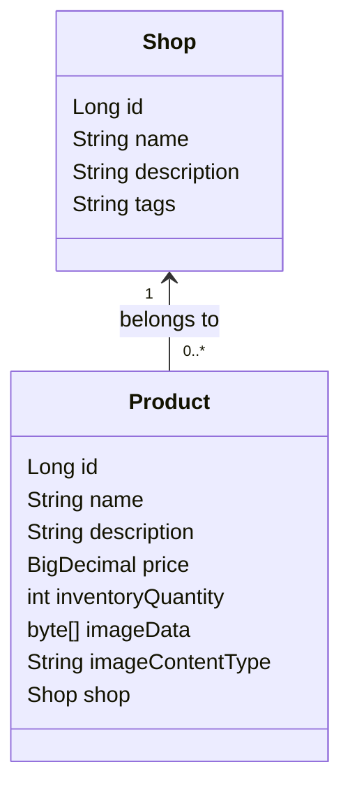
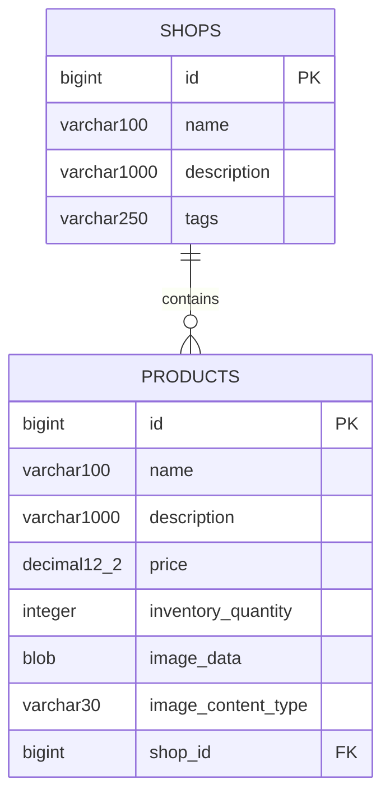

# Mini-Shopify - Milestone 1 merchant prototype

This contribution implements the merchant side: create a shop, add products with
actual picture uploads, and view the saved shop catalog. The customer side can use
the same Shop and Product models and repositories.

## Run in IntelliJ

1. Extract the ZIP and open the folder containing `pom.xml` in IntelliJ.
2. Import it as a Maven project and choose JDK 17 or 21.
3. Run `MiniShopifyApplication`.
4. Visit http://localhost:8080 (redirects to `/merchant`).

The project targets Java 17 bytecode, which also runs on Java 21. Keep the CI,
Maven compiler settings, and Azure runtime compatible when integrating with your
team's project. This is a standalone contribution; do not overwrite your team's
existing `pom.xml`, application entry point, or workflow without integrating them.

## Build, test, package, and run

With Maven installed:

```bash
mvn clean verify
java -jar target/mini-shopify.jar
```

With the included wrapper on macOS/Linux:

```bash
chmod +x mvnw
./mvnw clean verify
java -jar target/mini-shopify.jar
```

Windows: `mvnw.cmd clean verify`.

IntelliJ's Maven panel can also run Lifecycle -> verify. The tests use a separate
in-memory H2 database and do not erase your application's saved data.

## Implemented

- Shop form: name, description, and comma-separated categories/tags.
- Normalized lowercase tags, with duplicate tags removed.
- Merchant dashboard showing stored shops.
- Product form: name, description, price in CAD, inventory quantity, picture.
- Actual PNG/JPEG upload (up to 5 MB), stored in the database.
- Product picture endpoint; pictures are checked using their content.
- Shop catalog with picture, description, price, and stock quantity.
- Server-side form validation for required fields, positive prices, and
  nonnegative inventory.
- MVC integration tests and a service unit test.
- GitHub Actions workflow to test and package on pushes and pull requests.

## Prototype limitations and teammate scope

This is a shared merchant prototype: there is no login, merchant ownership check,
or access control. Anyone with the URL can create shops and add products. Shop
names are not unique. Categories/tags are a comma-separated string in `Shop.tags`.
There is no product editing/deletion, customer search, customer-facing shop page,
cart, checkout, order model, payment, or inventory decrement during purchase yet.
The merchant catalog is a preview of saved products. Do not treat stock validation
on product creation as the final purchase-inventory rule.

See [INTEGRATION.md](INTEGRATION.md) before combining contributions.

## Local persistence

The default database is a persistent H2 file under `./data/`. Products, pictures,
and shops survive a normal stop/start. Do not commit these database files. Run
the app from the same working directory to reuse that data.

H2 is suitable for this single-instance prototype. Before introducing multiple
app instances, use a shared database and plan transactional checkout/inventory
handling. Hibernate `ddl-auto=update` is a prototype convenience; use versioned
schema migrations as the application grows.

## Azure setup (not deployed by this ZIP)

Create a separate App Service for Mini-Shopify; the previous AddressBook deployment
is a different app. Choose Java SE with Java 17 or 21 and the course's Free F1 plan
where your subscription permits it. Connect your team repository's `main` branch
through Deployment Center, and keep tests enabled in the generated Maven build.

In App Service environment variables, set:

```text
SPRING_PROFILES_ACTIVE=azure
```

The Azure profile stores the H2 file at `/home/minishopify`, under App Service's
persistent home directory. This design is for one instance. Confirm persistence
by restarting the app and checking that a test shop and picture still load.

No Azure credentials or deployment secrets are included. Actual deployment and
the live URL must be set up by your team. The included CI workflow builds and
tests; it does not deploy on its own.

## Demo

1. Open `/merchant`, then Create a shop.
2. Enter a name, description, and tags; save.
3. Add a product with a small PNG/JPEG, price `19.95`, inventory `8`.
4. Confirm that the catalog shows its details and uploaded picture.
5. Add another shop and confirm its catalog starts empty.
6. Show the tests, reviewed feature PR, green CI, and your live Azure version.

## Model UML

Only model classes appear here. Forms, services, controllers, and repositories are
intentionally omitted.



## H2 database schema

Hibernate generates these tables from the entities. Physical column names use
Spring Boot's default naming strategy.



All listed columns are non-null. IDs are generated by the database. A product
holds the foreign key `shop_id`; `Shop` has no collection field in this version.
Fetch a shop's products through `ProductRepository`.
